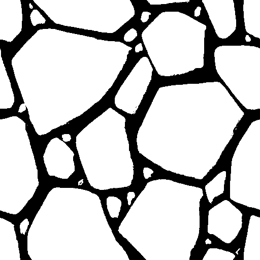
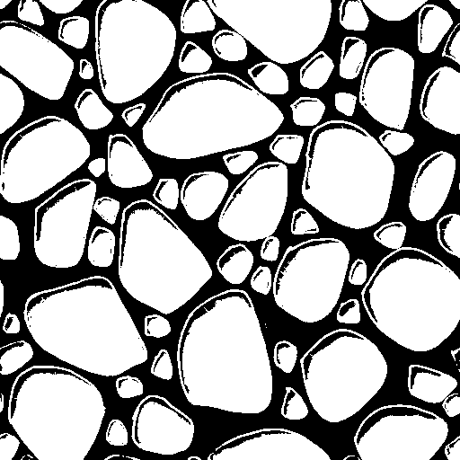

# Comment lancer le code

Tout d'abord, exécutez les commandes suivantes afin de créer le dossier de compilation:
```sh
mkdir build
cd build
cmake ..
make
```

## Kmeans

Toujours depuis le dossier `build`, vous pouvez exécuter individuellement le binary de *kmeans*. La commande prend quelques arguments:
- l'image d'entrée (**-i**)
- le nombre de classes (**-k**)
- l'image de vérité-terrain pour le comparatif (**-gt** --optionnel)
- la version de l'implémentation à utiliser (**-v** --optionnel)
- l'image de sortie de la segmentation (**-o** --optionnel)

Par défaut (sans argument), le comparatif avec la vérité-terrain est désactivée, l'implémentation utilisée est celle d'*opencv*, et l'image de sortie est écrite dans le fichier à l'adresse `data/images/default_output.png` (écrasant donc quelquonque itération précédente !).

Les images à tester sont d'ailleurs dans le dossier `data/images`. Il est préférable d'utiliser les images de texture puisque ces dernières ont aussi leur vérité terrain à disposition afin d'évaluer nos métriques.

Voici quelques exemples possibles d'appel depuis le dossier `build`:

```sh
# avec seulement les arguments obligatoires
./bin/kmeans -i=../data/images/texture3.png -k=2
```

On obtient:
```sh
>Program called with the following arguments:
>        image file: ../data/images/texture3.png
>        k: 2
>        output image file: ../data/images/default_output.png
>
>m: [512 x 512] ch: 3 type: CV_8UC3
>gt: [0 x 0] ch: 1 type: CV_8UC1
>
>Compactness: 1.88872e+08
```

et l'image suivante:



---

```sh
#en ajoutant le choix de la version et de la vérité-terrain
./bin/kmeans -i=../data/images/texture11.png -k=2 -gt=../data/images/texture11_VT.png -v=1
```

On obtient donc:

```sh
>Program called with the following arguments:
>        image file: ../data/images/texture11.png
>        k: 2
>        ground truth segmentation: ../data/images/texture11_VT.png
>        version: 1
>        output image file: ../data/images/default_output.png
>
>m: [512 x 512] ch: 3 type: CV_8UC3
>gt: [512 x 512] ch: 3 type: CV_8UC3
>
>
>Compactness: 5.29946e+06
>Précision: 0.985759
>Sensibilité: 0.922328
>DSC: 0.952989
```

et l'image suivante:



## Mean-shift

Même chose pour mean-shift, vous pouvez exécuter individuellement le binary de *meanshiftComp*. La commande prend les arguments:
- l'image d'entrée (**-i**)
- le nombre de classes (**-k**)
- l'image de vérité-terrain pour le comparatif (**-gt** --optionnel)
- le seuil de tolérance spatiale (**-hs**)
- le seuil de tolérance colorimétrique (**-hc**)
- Le seuil d'arrêt (**-e**)
- Le nombre maximal d'itérations (**-m**)
- l'image de sortie de la segmentation (**-o** --optionnel)

La méthode d'exécution est exactement la même.

## Test global

Enfin, nous avons concocté le script de test `test_kmeans.sh`, qui lance les trois implémentations pour $k=2$ et pour chaque image de texture, tout en les comparant aux VT afin d'obtenir les métriques nécessaires pour l'évaluation de nos méthodes. Il enregistre les images de sortie en accordance avec l'image à segmenter et la version utilisée (*0* pour *opencv*, *1* pour la nôtre et *2* pour le *mean-shift*).

Pour le lancer, il suffit de se placer dans le dossier source du projet (pas dans build !) et tout simplement faire:

```sh
./test_kmeans.sh
```