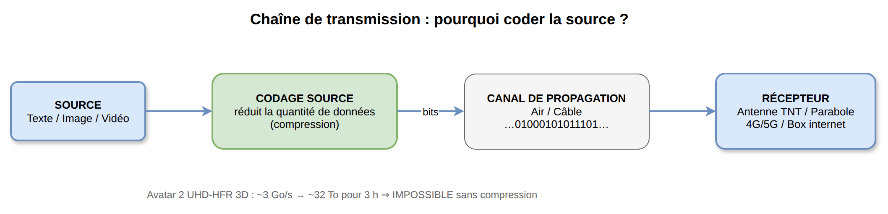
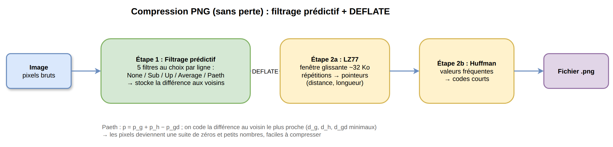
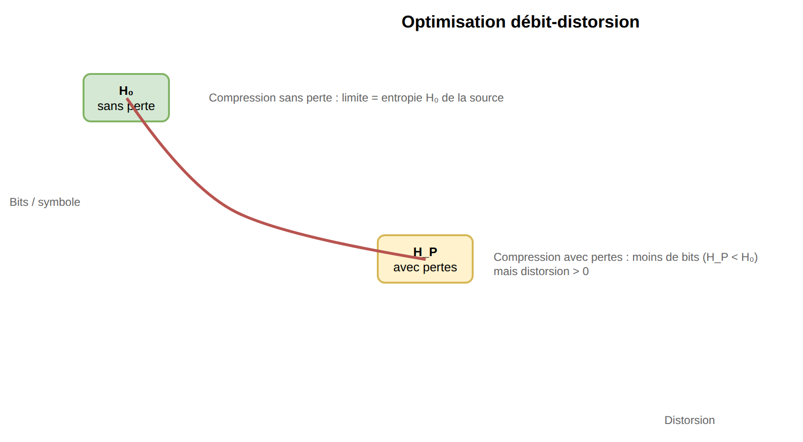
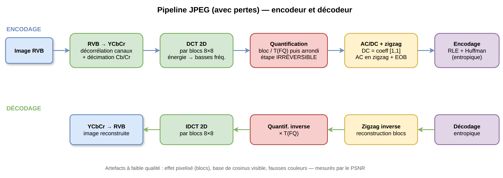
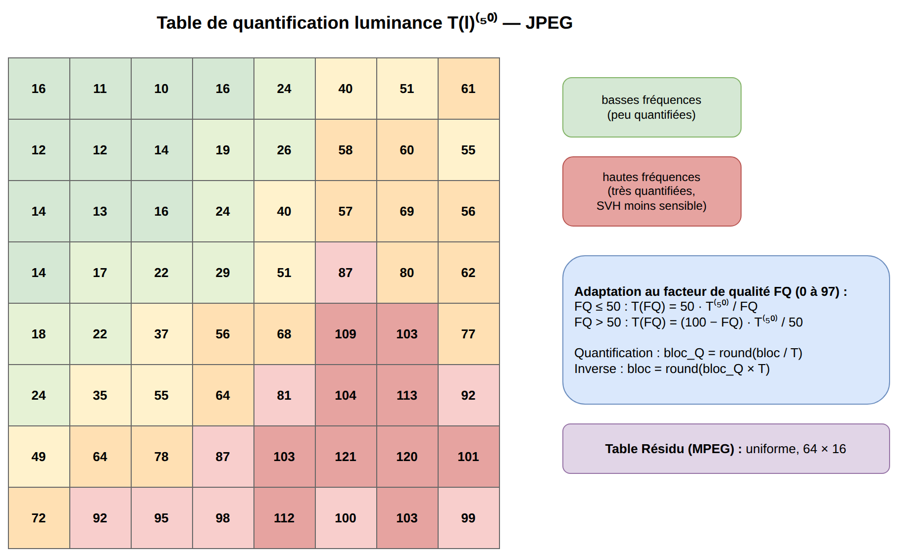
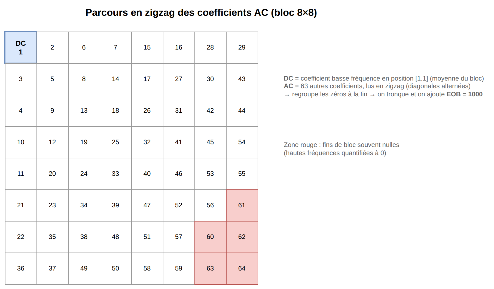
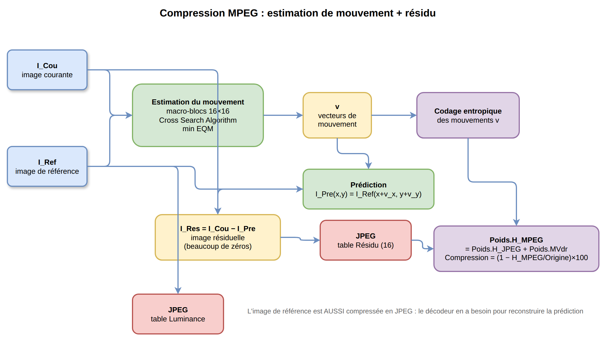
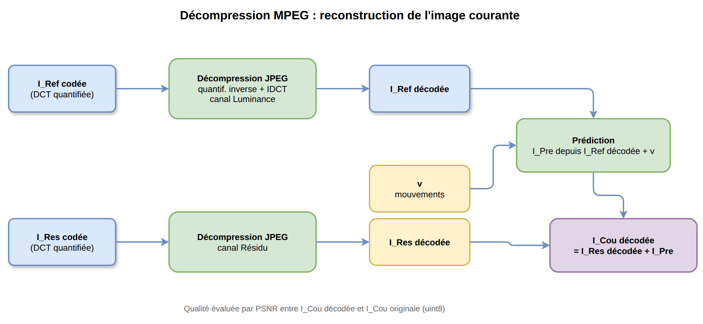
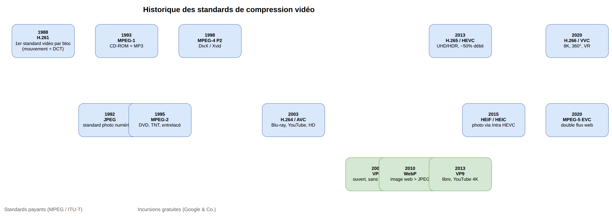
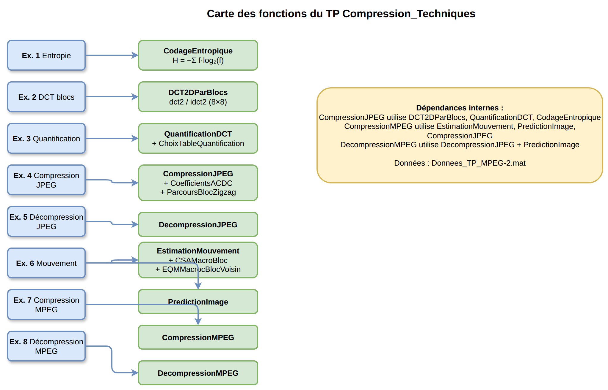

# CSIV — Compression, Streaming, Interaction Vidéo

## Course Material for Exam Preparation

**Institution:** INP-ENSEEIHT — 3SN Image et Multimédia  
**Academic Year:** 2026-2027  
**Language:** French (course), English (this material)

---

## Table des matières / Table of Contents

1. [Pourquoi compresser ? Les ordres de grandeur](#1-pourquoi-compresser-les-ordres-de-grandeur)
2. [Théorie de l'information et entropie](#2-théorie-de-linformation-et-entropie)
3. [Codage source : sans perte vs avec pertes](#3-codage-source-sans-perte-vs-avec-pertes)
4. [Optimisation débit-distorsion](#4-optimisation-débit-distorsion)
5. [Décorrélation des canaux (espace couleur YCbCr)](#5-décorrélation-des-canaux-espace-couleur-ycbcr)
6. [Décorrélation spatiale : la DCT 2D par blocs](#6-décorrélation-spatiale-la-dct-2d-par-blocs)
7. [Quantification](#7-quantification)
8. [Encodage des coefficients : AC/DC, parcours en zigzag, EOB](#8-encodage-des-coefficients-acdc-parcours-en-zigzag-eob)
9. [Reconstruction JPEG et artefacts](#9-reconstruction-jpeg-et-artefacts)
10. [Compression vidéo : redondance spatio-temporelle](#10-compression-vidéo-redondance-spatio-temporelle)
11. [Estimation du mouvement : block matching et Cross Search](#11-estimation-du-mouvement-block-matching-et-cross-search)
12. [Compensation du mouvement et image prédite](#12-compensation-du-mouvement-et-image-prédite)
13. [Image résiduelle et codage MPEG](#13-image-résiduelle-et-codage-mpeg)
14. [Décompression MPEG et PSNR](#14-décompression-mpeg-et-psnr)
15. [Historique des standards de compression](#15-historique-des-standards-de-compression)
16. [Exercice guidé : le TP Compression_Techniques (JPEG + MPEG)](#16-exercice-guidé-le-tp-compression_techniques-jpeg--mpeg)
17. [Questions type examen avec corrigé](#17-questions-type-examen-avec-corrigé)
18. [Formulaire : équations clés à connaître](#18-formulaire-équations-clés-à-connaître)

---

## 1. Pourquoi compresser ? Les ordres de grandeur

### Le problème

Une image non compressée est énorme. Une image UHD (4K) RGB 24 bits pèse environ **24 Mo**. Une vidéo UHD-HFR 3D (type *Avatar 2*, 60 i/s) génère un débit d'environ **3 Go/s**, soit environ **32 To** pour 3 heures de film.

> **32 To est impossible à stocker ou transmettre en pratique.**

### L'objectif

Coder la source pour **diminuer la quantité de données à transmettre** tout en restant certain de bien décoder à la réception.

### Les deux familles de compression

| Type            | Principe                                                 | Réversible ? | Exemples                    |
| --------------- | -------------------------------------------------------- | ------------ | --------------------------- |
| **Sans perte**  | Élimine uniquement les redondances mathématiques         | Oui          | PNG, DEFLATE, LZ77, Huffman |
| **Avec pertes** | Élimine définitivement des informations peu perceptibles | Non          | JPEG, MPEG, H.264, HEVC     |



*Figure : Chaîne de transmission : source → codage source → canal → récepteur*

---

## 2. Théorie de l'information et entropie

### Claude Shannon (1948)

La théorie de l'information quantifie mathématiquement la notion d'information pour optimiser stockage et transmission.

- **Unité :** le *bit*. Un bit dissipe l'incertitude entre deux choix équiprobables (pile ou face).
- **Entropie :** mesure de l'incertitude ou de la surprise d'une source. Plus un événement est imprévisible, plus son entropie est élevée, plus il contient d'information.

### Formule de l'entropie

Pour une source $S$ composée de symboles $S_k \in S$ avec fréquence d'apparition $f_k$ :

$$H(S) = -\sum_{S_k \in S} f_k \log_2(f_k)$$

L'entropie $H(S)$ correspond au **plus petit nombre de bits en moyenne par symbole** pour coder la source sans perte et pouvoir la décoder sans erreur.

### Applications

Compression, télécommunications, cryptographie.

---

## 3. Codage source : sans perte vs avec pertes

### Compression sans perte

Le format **PNG** (Portable Network Graphics) est sans perte. Il réduit le poids en éliminant uniquement les redondances mathématiques, sans supprimer aucun détail.

Pipeline PNG :

1. **Filtrage prédictif** (5 filtres au choix ligne par ligne : None, Sub, Up, Average, Paeth)
2. **Algorithme DEFLATE** = LZ77 + codage de Huffman

- **LZ77** : détecte les répétitions de chaînes via une fenêtre glissante (~32 Ko) et les remplace par des pointeurs (distance, longueur).
- **Huffman** : remplace les valeurs les plus fréquentes par des codes très courts.

### Compression avec pertes

Le format **JPEG** (Joint Photographic Experts Group, norme 1992) élimine définitivement les détails microscopiques que l'œil humain ne perçoit pas.

JPEG normalise uniquement l'algorithme et le format de décodage. L'encodage est laissé libre aux industriels, avec la contrainte que le décodeur doit respecter le standard (fichiers de conformité).



*Figure : Pipeline PNG : filtrage prédictif + DEFLATE (LZ77 + Huffman)*

---

## 4. Optimisation débit-distorsion

### Définitions

- **Débit :** nombre de bits par seconde (ou par symbole).
- **Distorsion :** mesure de la perte de qualité entre l'image d'origine et l'image reconstruite.

### Le compromis

Réduire le débit en réduisant le nombre de bits par symbole augmente la distorsion. L'objectif est de trouver le meilleur compromis qualité / taille.

```
Compression sans perte  → H₀  → pas de distorsion
Compression avec pertes → H_P → distorsion > 0
```



*Figure : Courbe débit-distorsion : H₀ sans perte, H_P avec pertes*

---

## 5. Décorrélation des canaux (espace couleur YCbCr)

### Pourquoi changer d'espace couleur ?

Dans l'espace RVB, les trois canaux (Rouge, Vert, Bleu) sont fortement corrélés. L'œil humain (SVH — Système Visuel Humain) est :

- Très sensible aux variations de **luminance**
- Peu sensible aux variations de **chrominance** (couleur)

### Changement d'espace de représentation

On passe de RVB à **YCbCr** :

| Composante                 | Signification              | Traitement                     |
| -------------------------- | -------------------------- | ------------------------------ |
| **Y** (Luminance)          | Intensité / luminosité     | Conservée en pleine résolution |
| **Cb** (Chrominance bleue) | Différence bleu-luminance  | Peut être décimée              |
| **Cr** (Chrominance rouge) | Différence rouge-luminance | Peut être décimée              |

Les chrominances peuvent être sous-échantillonnées (décimées) car l'œil y est moins sensible. Cela réduit le volume de données sans perte visuelle perceptible.

### Normes TV

- **SDTV (1948, URSS) :** 576i, 625 lignes à 25 i/s
- **HDTV :** définition supérieure, rapport de contraste différent

---

## 6. Décorrélation spatiale : la DCT 2D par blocs

### Principe

La **DCT (Discrete Cosine Transform)** 2D par blocs de 8×8 pixels concentre l'énergie de l'image sur les **basses fréquences**. Le SVH est moins sensible aux hautes fréquences, qui peuvent donc être davantage quantifiées (perdues).

### Formule de la DCT 2D

Pour un bloc $8\times8$ :

$$DCT2D(i,j) = \sum_{x=0}^{7}\sum_{y=0}^{7} \text{bloc}(x,y) \cdot C(i) \cdot C(j) \cdot \cos\left(\frac{(2x+1)i\pi}{16}\right) \cdot \cos\left(\frac{(2y+1)j\pi}{16}\right)$$

avec $C(0) = \frac{1}{\sqrt{2}}$ et $C(k) = 1$ pour $k > 0$.

La DCT 2D se décompose en deux DCT 1D, ce qui accélère le calcul.

### IDCT (DCT inverse)

$$IDCT2D(x,y) = \sum_{i=0}^{7}\sum_{j=0}^{7} \text{bloc}(i,j) \cdot C(i) \cdot C(j) \cdot \cos\left(\frac{(2x+1)i\pi}{16}\right) \cdot \cos\left(\frac{(2y+1)j\pi}{16}\right)$$

avec $C(0) = \frac{2}{\sqrt{2}}$ (noté 2 dans le cours) et $C(k) = 1$ sinon.

### Dans le code MATLAB

`DCT2DParBlocs(sens, I, methode, taille_bloc)` applique `dct2` (Direct) ou `idct2` (Inverse) bloc par bloc de 8×8.



*Figure : Pipeline complet JPEG : encodage et décodage*

---

## 7. Quantification

### Principe

La quantification divise les coefficients DCT par une table de quantification puis arrondit. C'est l'étape **irréversible** (perte d'information).

### Table de quantification luminance $T(l)^{(50)}$ (FQ = 50)

```
16  11  10  16  24  40  51  61
12  12  14  19  26  58  60  55
14  13  16  24  40  57  69  56
14  17  22  29  51  87  80  62
18  22  37  56  68 109 103  77
24  35  55  64  81 104 113  92
49  64  78  87 103 121 120 101
72  92  95  98 112 100 103  99
```

Les hautes fréquences ont des valeurs de quantification plus grandes → plus perdues.

### Adaptation au facteur de qualité FQ (0 à 97)

$$T(l)^{(FQ)} = \begin{cases} \dfrac{50 \cdot T(l)^{(50)}}{FQ} & \text{si } FQ \in ]0, 50[ \\[6pt] \dfrac{(100 - FQ) \cdot T(l)^{(50)}}{50} & \text{si } FQ \in ]50, 97] \end{cases}$$

### Quantification d'un bloc

$$\text{bloc}_Q = \text{round}\left(\frac{\text{bloc}}{T(l)^{(FQ)}}\right)$$

### Quantification inverse

$$\text{bloc} = \text{round}(\text{bloc}_Q \cdot T(l)^{(FQ)})$$

### Tables par canal

- **Luminance :** table ci-dessus
- **Chrominance :** table différente (valeurs plus grandes pour hautes fréquences, nombreuses 99)
- **Résidu (MPEG) :** table uniforme, toutes les valeurs = 16

### Dans le code

`QuantificationDCT(sens, I, canal, F_Qualite, taille_bloc)` avec `sens = 'Direct'` ou `'Inverse'`.



*Figure : Table de quantification luminance et adaptation au FQ*

---

## 8. Encodage des coefficients : AC/DC, parcours en zigzag, EOB

### Séparation AC/DC

Dans chaque bloc 8×8 quantifié :

- **Coefficient DC** : position [1,1] (composante basse fréquence, moyenne du bloc)
- **Coefficients AC** : les 63 autres coefficients (hautes fréquences)

### Parcours en zigzag

Les coefficients AC sont réorganisés selon un parcours en zigzag, du coin haut-gauche vers le coin bas-droit, jusqu'au dernier coefficient non nul. Ce parcours groupe les zéros à la fin du vecteur.

### Symbole EOB (End Of Block)

Après avoir supprimé les zéros finaux non codés, on ajoute un symbole de fin de bloc, représenté par la valeur numérique **1000**.

### Dans le code

`CoefficientsACDC(I_Quant, taille_bloc)` sépare DC et AC, applique `ParcoursBlocZigzag`, tronque les zéros finaux et ajoute 1000 comme EOB.



*Figure : Parcours en zigzag d'un bloc 8×8*

---

## 9. Reconstruction JPEG et artefacts

### Décompression JPEG

1. Quantification inverse (multiplier par la table)
2. DCT inverse (IDCT) bloc par bloc

### Artefacts visuels à basse qualité

- Effet pixelisé (blocs visibles)
- Base de cosinus visible
- Transitions de couleurs
- Fausses couleurs

### Mesure de qualité : PSNR

Le PSNR (Peak Signal-to-Noise Ratio) en dB compare l'image reconstruite à l'image d'origine. Plus le PSNR est élevé, meilleure est la qualité.

---

## 10. Compression vidéo : redondance spatio-temporelle

### Le problème

Dans une vidéo, deux images successives sont très similaires. Les coder indépendamment (MJPEG) gaspille de l'espace.

### Trois niveaux de codage d'une vidéo

| Niveau | Principe                                               | Standard |
| ------ | ------------------------------------------------------ | -------- |
| 1      | Aucun action : chaque image codée en JPEG indépendante | MJPEG    |
| 2      | Différence entre images successives                    | —        |
| 3      | Différence compensée par mouvement                     | MPEG     |

### Notations clés (cours)

- $I^{Ref}$ : Image de référence, taille $M \times N$
- $I^{Cou}$ : Image courante, taille $M \times N$
- $v$ : Matrice des vecteurs de déplacement, taille $M \times N \times 2$ (dx, dy)
- $I^{Pre}$ : Image prédite de $I^{Cou}$ à partir de $I^{Ref}$ et $v$
  $$I^{Pre}(x,y) = I^{Ref}(x + v_x, y + v_y)$$
- $I^{Res}$ : Image résiduelle = différence entre prédite et courante
  $$I^{Res}(x,y) = I^{Pre}(x,y) - I^{Cou}(x,y)$$

### Pourquoi coder $I^{Res}$ et $v$ au lieu de $I^{Cou}$ ?

- $I^{Res}$ contient beaucoup de valeurs nulles
- $v$ contient beaucoup de déplacements similaires

---

## 11. Estimation du mouvement : block matching et Cross Search

### Approche par patchs (MPEG)

L'image courante est découpée en **macro-blocs de 16×16 pixels**. Pour chaque macro-bloc, on recherche le macro-bloc le plus proche dans l'image de référence au sens de l'**EQM (Erreur Quadratique Moyenne)**.

### Déplacement

Avec $v^C$ = coordonnées du premier pixel du macro-bloc dans $I^{Cou}$ et $v^R$ = celles dans $I^{Ref}$ :

$$v = v^R - v^C$$

### Recherche optimale

$$v^* = \arg\min_v \sum_{i,j=1}^{16} \left( I^{Ref}_{v^C + v + (i,j)} - I^{Cou}_{v^C + (i,j)} \right)^2$$

### Cross Search Algorithm (CSA)

1. Se placer à la position de départ $v^C$ dans $I^{Ref}$
2. Calculer l'EQM centrale ($EQMC$)
3. Déplacer le macro-bloc de recherche d'un pixel dans les 4 directions (haut, gauche, droite, bas) et calculer 4 nouvelles EQM
4. Si une erreur est plus faible que celle du centre, se déplacer vers celle-ci ; sinon on a atteint un minimum local, on s'arrête

**Bonus :** utiliser 8 voisins au lieu de 4.

### Dans le code

- `EstimationMouvement(Ic, Ir)` : boucle sur les macro-blocs 16×16, appelle `CSAMacroBloc`
- `CSAMacroBloc(MB_IC, Vp, IRef)` : implémente le CSA avec 4 voisins
- `EQMMacrocBlocVoisin(...)` : calcule l'EQM pour un voisin donné

---

## 12. Compensation du mouvement et image prédite

### Principe

Une fois les mouvements estimés, on remplace chaque macro-bloc de $I^{Cou}$ par le macro-bloc de $I^{Ref}$ associé au déplacement estimé. Cela donne l'**image prédite** $I^{Pre}$.

### Dans le code

`PredictionImage(Ir, MVr)` :

- Parcourt les macro-blocs 16×16 de $I^{Ref}$
- Pour chaque bloc, lit le vecteur de déplacement $(dx, dy)$ depuis $MVr$
- Copie les pixels de $I^{Ref}$ décalés par $(dx, dy)$ vers $I^{Pre}$
- Gère les bords par clamp (min/max entre 1 et dimension)

---

## 13. Image résiduelle et codage MPEG

### Image résiduelle

$$I^{Res} = I^{Cou} - I^{Pre}$$

L'image résiduelle contient peu d'informations (beaucoup de zéros) car la prédiction compense déjà le mouvement.

### Ordre des étapes de compression MPEG (`CompressionMPEG`)

1. Calculer les cartes de mouvements $v$ des macro-blocs de $I^{Cou}$
2. Calculer la prédiction $I^{Pre}$ de $I^{Cou}$ à partir de $I^{Ref}$ et $v$
3. Calculer l'image résiduelle $I^{Res} = I^{Cou} - I^{Pre}$
4. Compression JPEG de l'image de référence $I^{Ref}$ (canal Luminance)
5. Compression JPEG de l'image résiduelle $I^{Res}$ (canal Résidu, table de quantification uniforme à 16)
6. Codage entropique des mouvements $v$ et ajout du poids au poids de l'image résiduelle

### Table de quantification du résidu (MPEG)

Toutes les 64 valeurs = 16 (uniforme). Le facteur de qualité FQ reste le même entre référence et résidu.

### Dans le code

`CompressionMPEG(Ic_Originale, Ir_Originale, canal, methode, F_Qualite)` retourne :

- `IRes_Codee` : résidu DCT quantifié
- `MVdr` : matrice des vecteurs de déplacement relatifs
- `Ir_Codee` : référence DCT quantifiée
- `Poids` : poids à chaque étape
- `Compression` : taux de compression final



*Figure : Pipeline de compression MPEG*

---

## 14. Décompression MPEG et PSNR

### Ordre des étapes de décompression (`DecompressionMPEG`)

1. Décompression JPEG de l'image de référence $I^{Ref}$ (canal Luminance)
2. Calcul de la prédiction $I^{Pre}$ à partir de $I^{Ref}$ décodée et des mouvements $v$
3. Décompression JPEG de l'image résiduelle $I^{Res}$ (canal Résidu)
4. Recomposition : $I^{Cou}_d = I^{Res}_d + I^{Pre}$

### Dans le code

`DecompressionMPEG(IRes_Codee, Ir_Codee, MVdr, canal, methode, F_Qualite)` retourne :

- `Ic_Decodee` : image courante reconstruite
- `Ir_Decodee` : image de référence reconstruite

### PSNR

Comparaison de l'image reconstruite à l'image d'origine. Utilisé pour évaluer la qualité selon le facteur de qualité FQ.



*Figure : Pipeline de décompression MPEG*

---

## 15. Historique des standards de compression

### Timeline (payante)

| Année | Standard     | Description                                                                      |
| ----- | ------------ | -------------------------------------------------------------------------------- |
| 1988  | H.261        | Premier standard de compression vidéo par bloc (compensation de mouvement + DCT) |
| 1992  | JPEG         | DCT avec perte, standard universel de la photo numérique                         |
| 1993  | MPEG-1       | CD-ROM, popularise le MP3                                                        |
| 1995  | MPEG-2       | DVD, câble, TNT, flux entrelacés haut débit                                      |
| 1998  | MPEG-4 P2    | DivX, Xvid, excellent rapport qualité/poids                                      |
| 2003  | H.264 / AVC  | Blu-ray, YouTube, streaming HD, smartphones                                      |
| 2013  | H.265 / HEVC | UHD, HDR, -50% de débit, brevets complexes                                       |
| 2015  | HEIF / HEIC  | Conteneur image, encodage Intra HEVC, -50% poids photo                           |
| 2020  | H.266 / VVC  | 8K, 360°, VR, réduction drastique du débit                                       |
| 2020  | MPEG-5 EVC   | Double flux (EVC/LCEVC) pour le web                                              |

### Incursions (gratuites) de Google & Co

| Année | Codec        | Description                                    |
| ----- | ------------ | ---------------------------------------------- |
| 2003  | H.264 / AVC  | (idem timeline)                                |
| 2008  | VP8          | Ouvert, sans redevance                         |
| 2010  | WebP         | Image pour le web, issu de VP8, mieux que JPEG |
| 2013  | H.265 / HEVC | (idem timeline)                                |
| 2013  | VP9          | Libre, concurrent de HEVC, YouTube 4K          |

> *Note : Les dates de standardisation (notamment H.266/VVC et MPEG-5 EVC en 2020) sont confirmées par les supports de cours. Pour les standards les plus récents postérieurs à 2020, vérifier sur les sites officiels (ITU-T, MPEG, Alliance for Open Media).*



*Figure : Timeline des standards de compression*

---

## 16. Exercice guidé : le TP Compression_Techniques (JPEG + MPEG)

Ce TP (INP-ENSEEIHT, 3SN, 2026-2027) est divisé en deux parties :

- **Exercices 1–5 :** Codage et décodage JPEG
- **Exercices 6–8 :** Codage et décodage MPEG

Toutes les images de test sont dans `Donnees_TP_MPEG-2.mat`.

### Exercice 1 — Codage entropique d'un signal

**Objectif :** Calculer l'entropie et le poids d'un signal quelconque.

**Formule :** $H = -\sum f_k \log_2(f_k)$

**Fonction à implémenter :** `CodageEntropique(V_coeff)`

```matlab
function [poids, H] = CodageEntropique(V_coeff)
    n = numel(V_coeff);
    [~, ~, indices] = unique(V_coeff);
    f = accumarray(indices, 1) / n;
    f = f(f > 0);
    H = -sum(f .* log2(f));
    poids = H * n / (8 * 1024); % en ko
end
```

**Valeur de référence attendue (I_Ent_1) :** H ≈ 26.947 ko, cohérent avec `entropy()` de MATLAB.

**Points d'attention examen :**

- Généralisable à n'importe quel vecteur (pas seulement niveaux de gris 0–255)
- `unique` + `accumarray` pour compter les fréquences
- Ignorer les fréquences nulles avant `log2` (évite `log2(0)`)



*Figure : Carte des fonctions du TP*

---

### Exercice 2 — DCT 2D par blocs

**Objectif :** Appliquer la DCT 2D sur des blocs 8×8.

**Fonction :** `DCT2DParBlocs(sens, I, methode, taille_bloc)`

```matlab
function I_DCT = DCT2DParBlocs(sens, I, methode, taille_bloc)
    [height, width] = size(I);
    I_DCT = zeros(size(I));
    for i = 1:taille_bloc:height
        for j = 1:taille_bloc:width
            bloc = I(i:i+taille_bloc-1, j:j+taille_bloc-1);
            if strcmpi(sens, 'Direct')
                bloc_transforme = dct2(bloc);
            else
                bloc_transforme = idct2(bloc);
            end
            I_DCT(i:i+taille_bloc-1, j:j+taille_bloc-1) = bloc_transforme;
        end
    end
end
```

**Bonus :** `DCT2Rapide` — exploiter les redondances des coefficients (DCT 2D = deux DCT 1D séparables).

**Points d'attention examen :**

- La DCT concentre l'énergie sur les basses fréquences
- `dct2` / `idct2` de MATLAB
- Le bloc d'entrée de l'exercice 2 a déjà subi une IDCT → la DCT retrouve l'image initiale

---

### Exercice 3 — Quantification par blocs

**Objectif :** Quantifier les coefficients DCT avec une table selon le canal et le FQ.

**Fonction :** `QuantificationDCT(sens, I, canal, F_Qualite, taille_bloc)`

**Sous-fonction :** `ChoixTableQuantification(canal, F_Qualite)`

**Tables :**

- Luminance : table standard JPEG (8×8, voir section 7)
- Chrominance : table différente (plus de 99 en haute fréquence)
- Résidu : uniforme, toutes les valeurs = 16

**Adaptation FQ :**

- FQ > 50 : $T = (100-FQ) \cdot T^{(50)} / 50$
- FQ ≤ 50 : $T = 50 \cdot T^{(50)} / FQ$

**Quantification directe :** `round(bloc ./ T_Quant)`  
**Quantification inverse :** `round(bloc .* T_Quant)`

**Points d'attention examen :**

- L'étape est irréversible (arrondi)
- Les hautes fréquences sont plus quantifiées (perdues)
- La table dépend du canal

---

### Exercice 4 — Compression JPEG complète

**Objectif :** Chaîner DCT → Quantification → séparation AC/DC → encodage entropique.

**Fonction :** `CompressionJPEG(I_Origine, canal, methode, F_Qualite)`

**Sous-fonction clé :** `CoefficientsACDC(I_Quant, taille_bloc)`

1. Pour chaque bloc 8×8 :
   - DC = coefficient [1,1]
   - AC = reste du bloc en parcours zigzag, jusqu'au dernier non nul
   - Ajouter 1000 (EOB) à la fin du vecteur AC
2. Calculer l'entropie de AC et de DC séparément
3. Taux de compression = $(1 - \text{Poids}_{H\_JPEG} / \text{Poids}_{Origine}) \times 100$

**Valeurs de référence (I_for_JPEG, FQ=30, Luminance) :**

- Poids JPEG ≈ 4,97 ko
- Compression ≈ 92,2 %
- Nb coeffs AC ≈ 12 498
- Nb coeffs DC = nombre de blocs = $N/64$

**Points d'attention examen :**

- Séparation AC vs DC
- Parcours zigzag
- Symbole EOB = 1000
- Calcul du taux de compression

---

### Exercice 5 — Décompression JPEG et qualité

**Objectif :** Reconstituer l'image et mesurer le PSNR.

**Fonction :** `DecompressionJPEG(I_Codee, canal, methode, F_Qualite)`

1. Quantification inverse
2. IDCT bloc par bloc

**Analyse :** Faire varier FQ de 1 à 97, tracer poids et PSNR. Observer les artefacts à faible FQ.

**Valeurs de référence (FQ=30) :** Poids ≈ 30,7 ko, PSNR ≈ 47,4 dB

---

### Exercice 6 — Estimation et compensation du mouvement

**Objectif :** Estimer le mouvement par block matching (CSA) et prédire l'image courante.

**Fonctions :**

- `EstimationMouvement(Ic, Ir)` → `MVr`
- `CSAMacroBloc(MB_IC, Vp, IRef)` → `Vm` (4 voisins : centre, haut, gauche, droite, bas)
- `EQMMacrocBlocVoisin(...)` → EQM pour un voisin
- `PredictionImage(Ir, MVr)` → `Ip`

**Valeurs de référence :**

- Somme des mouvements : 5553
- Niveau de gris moyen de Ip : 82,48

**Bonus :** 8 voisins au lieu de 4.

**Points d'attention examen :**

- Macro-blocs 16×16
- EQM entre macro-blocs
- Recherche par descente (4 voisins)
- Gestion des bords (clamp)
- $I^{Pre}(x,y) = I^{Ref}(x+v_x, y+v_y)$

---

### Exercice 7 — Compression MPEG

**Objectif :** Compresser l'image courante via mouvement + résidu + JPEG.

**Fonction :** `CompressionMPEG(Ic_Originale, Ir_Originale, canal, methode, F_Qualite)`

**Étapes :**

1. `EstimationMouvement` → `MVdr`
2. `PredictionImage` → `Ip`
3. `IRes = Ic - Ip`
4. `CompressionJPEG(Ir, 'Luminance', ...)` → `Ir_Codee`
5. `CompressionJPEG(IRes, 'Residu', ...)` → `IRes_Codee`
6. `CodageEntropique(MVdr(:))` → poids des mouvements
7. `Poids.H_MPEG = Poids.H_JPEG + Poids.MVdr`
8. `Compression = (1 - H_MPEG / Origine) × 100`

**Table du résidu :** uniforme, toutes les valeurs = 16.

**Valeurs de référence (FQ=30) :**

- Image courante : 412 ko
- JPEG de la courante : 13,3 ko
- MPEG total : 5,62 ko (dont mouvements 1,24 ko)

**Points d'attention examen :**

- Pourquoi MPEG compresse mieux que JPEG seul (résidu peu énergétique + mouvements compacts)
- Le résidu est compressé avec la table 'Residu' (uniforme 16)
- Le poids des mouvements doit être ajouté

---

### Exercice 8 — Décompression MPEG et analyse qualité

**Objectif :** Reconstituer l'image courante et évaluer le PSNR.

**Fonction :** `DecompressionMPEG(IRes_Codee, Ir_Codee, MVdr, canal, methode, F_Qualite)`

**Étapes :**

1. `DecompressionJPEG(Ir_Codee, 'Luminance', ...)` → `Ir_Decodee`
2. `PredictionImage(Ir_Decodee, MVdr)` → `Ip`
3. `DecompressionJPEG(IRes_Codee, 'Residu', ...)` → `Ires_Decodee`
4. `Ic_Decodee = Ires_Decodee + Ip`

**Analyse :** Comparer JPEG vs MPEG pour différents FQ. Observer les artefacts et le PSNR.

---

## 17. Questions type examen avec corrigé

### Q1. Quelle est la formule de l'entropie de Shannon et que représente-t-elle ?

**Réponse :**
$$H(S) = -\sum_{S_k \in S} f_k \log_2(f_k)$$

C'est le nombre minimal de bits en moyenne par symbole pour coder une source sans perte. Elle mesure l'incertitude de la source.

---

### Q2. Différence entre compression sans perte et avec pertes. Donnez un exemple de chacun

**Réponse :**

- **Sans perte :** réversible, élimine uniquement les redondances. Exemple : PNG (filtrage prédictif + DEFLATE = LZ77 + Huffman).
- **Avec pertes :** irréversible, élimine des informations peu perceptibles. Exemple : JPEG (DCT + quantification + encodage entropique).

---

### Q3. Pourquoi passe-t-on de l'espace RVB à l'espace YCbCr dans JPEG ?

**Réponse :**
L'œil humain est très sensible à la luminance (Y) et peu aux chrominances (Cb, Cr). On peut donc décimer (sous-échantillonner) les chrominances sans perte visuelle perceptible, réduisant le volume de données.

---

### Q4. Quel est le rôle de la DCT 2D par blocs 8×8 dans JPEG ?

**Réponse :**
Concentrer l'énergie de l'image sur les basses fréquences. Le SVH est moins sensible aux hautes fréquences, qui peuvent être davantage quantifiées (perdues). La DCT 2D se décompose en deux DCT 1D pour accélérer le calcul.

---

### Q5. Quelle est la table de quantification du résidu en MPEG et pourquoi est-elle différente de celle de la luminance ?

**Réponse :**
Table uniforme : toutes les 64 valeurs = 16. Elle est différente car le résidu contient déjà peu d'énergie (la prédiction a compensé le mouvement), donc une quantification uniforme suffit ; une table non uniforme n'apporterait pas de gain supplémentaire.

---

### Q6. Expliquez le Cross Search Algorithm pour l'estimation du mouvement

**Réponse :**
Pour chaque macro-bloc 16×16 de l'image courante, on recherche le macro-bloc le plus proche dans l'image de référence au sens de l'EQM. En partant de la position initiale, on calcule l'EQM centrale puis les 4 EQM des voisins (haut, gauche, droite, bas). Si un voisin a une EQM plus faible, on s'y déplace ; sinon on a atteint un minimum local et on s'arrête.

---

### Q7. Quelle est la formule de l'image prédite et de l'image résiduelle ?

**Réponse :**
$$I^{Pre}(x,y) = I^{Ref}(x + v_x, y + v_y)$$
$$I^{Res}(x,y) = I^{Pre}(x,y) - I^{Cou}(x,y)$$

---

### Q8. Pourquoi code-t-on $I^{Res}$ et $v$ au lieu de $I^{Cou}$ directement en MPEG ?

**Réponse :**
$I^{Res}$ contient beaucoup de valeurs nulles (la prédiction a déjà enlevé la redondance temporelle) et $v$ contient beaucoup de déplacements similaires. Les deux sont donc beaucoup plus compressibles que l'image courante brute.

---

### Q9. Quel est le rôle du symbole EOB (End Of Block) et quelle valeur numérique lui est assignée dans ce TP ?

**Réponse :**
L'EOB marque la fin des coefficients AC significatifs d'un bloc, après suppression des zéros finaux. Dans ce TP, il est représenté par la valeur numérique **1000**.

---

### Q10. Comment calcule-t-on le taux de compression JPEG ?

**Réponse :**
$$\text{Compression} = \left(1 - \frac{\text{Poids}_{H\_JPEG}}{\text{Poids}_{Origine}}\right) \times 100$$

où $\text{Poids}_{H\_JPEG} = \text{Poids}_{AC} + \text{Poids}_{DC}$ (poids entropique des coefficients AC et DC).

---

### Q11. Quels sont les artefacts visuels attendus à faible facteur de qualité JPEG ?

**Réponse :**
Effet pixelisé (blocs visibles), base de cosinus visible, transitions de couleurs, fausses couleurs.

---

### Q12. Dans `CompressionMPEG`, pourquoi compresse-t-on l'image de référence $I^{Ref}$ en JPEG ?

**Réponse :**
L'image de référence doit être compressée (en JPEG) car elle sera nécessaire lors de la décompression pour recalculer la prédiction. Si on ne la compresse pas, le décodeur ne peut pas reconstruire l'image courante.

---

### Q13. Quelle est la différence entre `Exercice_7` et `Exercice_8` ?

**Réponse :**
`Exercice_7` effectue la **compression** MPEG (calcul mouvement, prédiction, résidu, codage JPEG des deux, entropie des mouvements). `Exercice_8` effectue la **décompression** (décodage JPEG référence, prédiction, décodage JPEG résidu, recomposition) et affiche le PSNR pour évaluer la qualité.

---

### Q14. Quelle est la formule d'adaptation de la table de quantification selon le FQ ?

**Réponse :**
$$T^{(FQ)} = \begin{cases} \dfrac{50 \cdot T^{(50)}}{FQ} & FQ \in ]0, 50[ \\[6pt] \dfrac{(100 - FQ) \cdot T^{(50)}}{50} & FQ \in ]50, 97] \end{cases}$$

---

### Q15. Quel est l'avantage de MPEG par rapport à MJPEG ?

**Réponse :**
MJPEG code chaque image indépendamment (comme du JPEG). MPEG exploite la redondance temporelle entre images successives via la compensation de mouvement : on ne code que le résidu et les vecteurs de mouvement, ce qui réduit drastiquement le débit.

---

## 18. Formulaire : équations clés à connaître

| Notion                 | Équation                                                                              |
| ---------------------- | ------------------------------------------------------------------------------------- |
| Entropie               | $H(S) = -\sum f_k \log_2(f_k)$                                                        |
| DCT 2D                 | $DCT2D(i,j) = \sum_{x,y} \text{bloc}(x,y) C(i)C(j) \cos(\cdot)\cos(\cdot)$            |
| IDCT 2D                | $IDCT2D(x,y) = \sum_{i,j} \text{bloc}(i,j) C(i)C(j) \cos(\cdot)\cos(\cdot)$           |
| Quantification directe | $\text{bloc}_Q = \text{round}(\text{bloc} / T)$                                       |
| Quantification inverse | $\text{bloc} = \text{round}(\text{bloc}_Q \cdot T)$                                   |
| Image prédite          | $I^{Pre}(x,y) = I^{Ref}(x+v_x, y+v_y)$                                                |
| Image résiduelle       | $I^{Res}(x,y) = I^{Pre}(x,y) - I^{Cou}(x,y)$                                          |
| Déplacement            | $v = v^R - v^C$                                                                       |
| Taux de compression    | $(1 - \text{Poids}_{compressé} / \text{Poids}_{original}) \times 100$                 |
| Table FQ               | $T^{(FQ)} = 50 \cdot T^{(50)} / FQ$ (FQ≤50) ou $(100-FQ) \cdot T^{(50)} / 50$ (FQ>50) |

---

## Bibliographie / Sources

- Supports de cours CSIV (CSIV_Cours_1 à 4), INP-ENSEEIHT, 3SN Image et Multimédia, 2026-2027
- TP Codages JPEG et MPEG (TP_CSIV_JPEG.pdf, TP_CSIV_MPEG.pdf), Compression_Techniques/
- Codes sources MATLAB : CodageEntropique.m, DCT2DParBlocs.m, QuantificationDCT.m, CompressionJPEG.m, DecompressionJPEG.m, EstimationMouvement.m, PredictionImage.m, CompressionMPEG.m, DecompressionMPEG.m, Exercice_1.m à Exercice_8.m
- Dates des standards : conformes aux supports de cours (H.266/VVC et MPEG-5 EVC : 2020)

---
---

## Voir aussi

- **[CSIV_Predicted_Quiz.md](CSIV_Predicted_Quiz.md)** — banque de 15 questions prédictives générées avec la méthodologie BrainMax (archétypes Explain / Predict / Refactor / Debug), ancrées dans le code réel du TP, avec corrigés et barème 0–3.
- **[diagrams/](diagrams/)** — les 10 schémas draw.io (sources `.drawio` éditables + exports `.png`).
